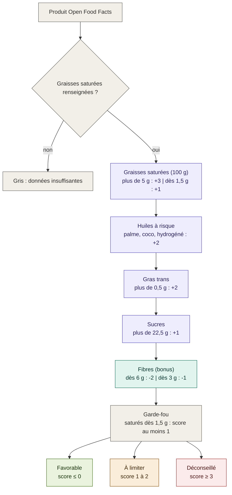

# Lipiq

This project was generated using [Angular CLI](https://github.com/angular/angular-cli) version 22.1.6.

## Development server

To start a local development server, run:

```bash
ng serve
```

Once the server is running, open your browser and navigate to `http://localhost:4200/`. The application will automatically reload whenever you modify any of the source files.

## Code scaffolding

Angular CLI includes powerful code scaffolding tools. To generate a new component, run:

```bash
ng generate component component-name
```

For a complete list of available schematics (such as `components`, `directives`, or `pipes`), run:

```bash
ng generate --help
```

## Building

To build the project run:

```bash
ng build
```

This will compile your project and store the build artifacts in the `dist/` directory. By default, the production build optimizes your application for performance and speed.

## Running unit tests

To execute unit tests with the [Vitest](https://vitest.dev/) test runner, use the following command:

```bash
ng test
```

## Running end-to-end tests

For end-to-end (e2e) testing, run:

```bash
ng e2e
```

Angular CLI does not come with an end-to-end testing framework by default. You can choose one that suits your needs.

## Additional Resources

## Comment fonctionne le score

Chaque produit part d'un score de 0. Chaque critère ajoute ou retire des points, puis le score final donne le statut.



| Score final | Statut      |
| ----------- | ----------- |
| 0 ou moins  | Favorable   |
| 1 à 2       | À limiter   |
| 3 ou plus   | Déconseillé |

> Indication générale, elle ne remplace pas un avis médical.
